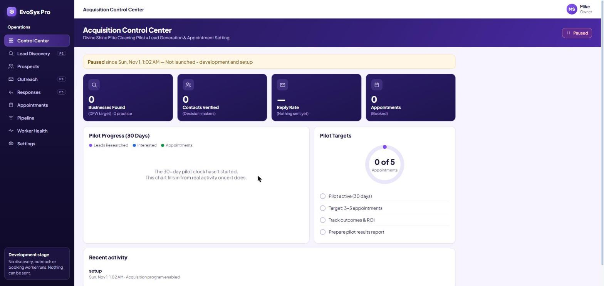
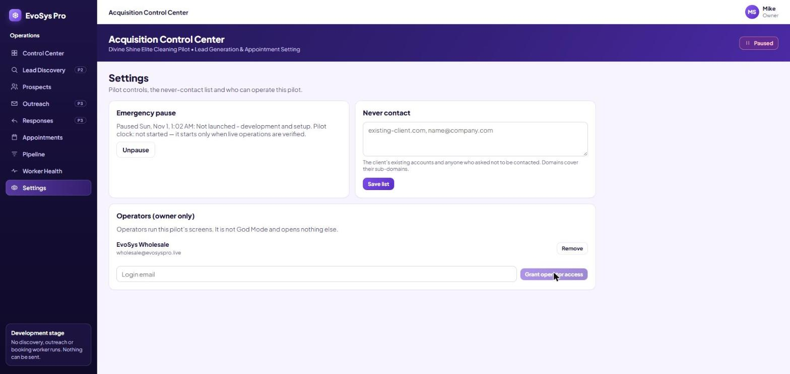
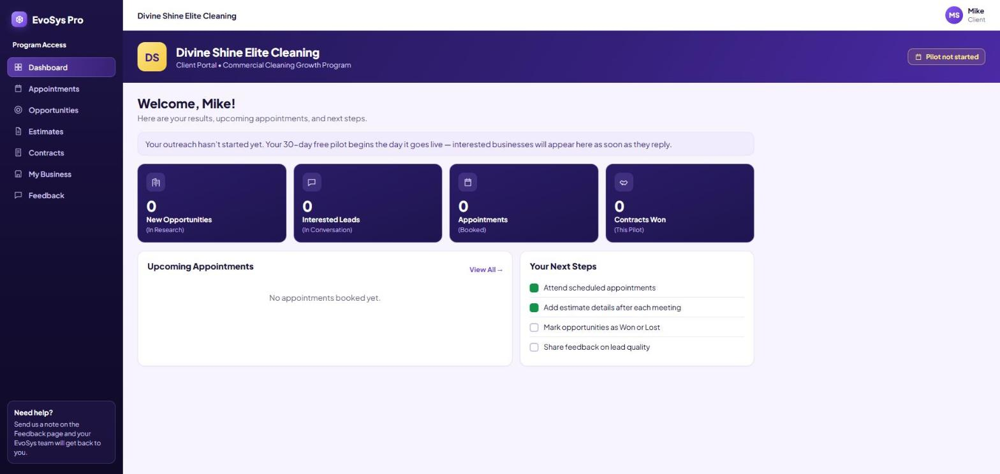
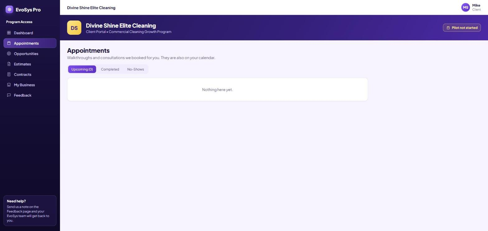

# Divine Shine acquisition pilot: production screenshots (2026-11-01 CT)

These were taken in a real Chrome against **app.evosyspro.live** on production build `e73e037`. No customer data is shown: the Divine Shine workspace was created minutes earlier and has no prospects.

| Screen | Who was signed in | File |
|---|---|---|
| Acquisition Control Center (paused, pilot clock not started) | God (owner) |  |
| Settings: wholesale@ granted as operator | God (owner) |  |
| Client portal dashboard | God viewing as the Divine Shine customer through the audited entry (no membership, **not** Ciara's login) |  |
| Client portal appointments | same as above |  |
| `/acquisition-ops` before the grant | wholesale@ |  |
