# Divine Shine acquisition pilot (Issue #452, PR #453): purple-theme screenshots

The owner chose the original purple EvoSys Pro / Divine Shine collage as the color reference on 2026-10-31. **Purple is the approved theme; do not revert to blue.**

All screenshots come from a real Chromium browser running against a throwaway local SQLite database. Every business and person shown is made up, and no production data appears.

| Screen | Desktop (1440) | Phone (390) |
|---|---|---|
| Client dashboard | 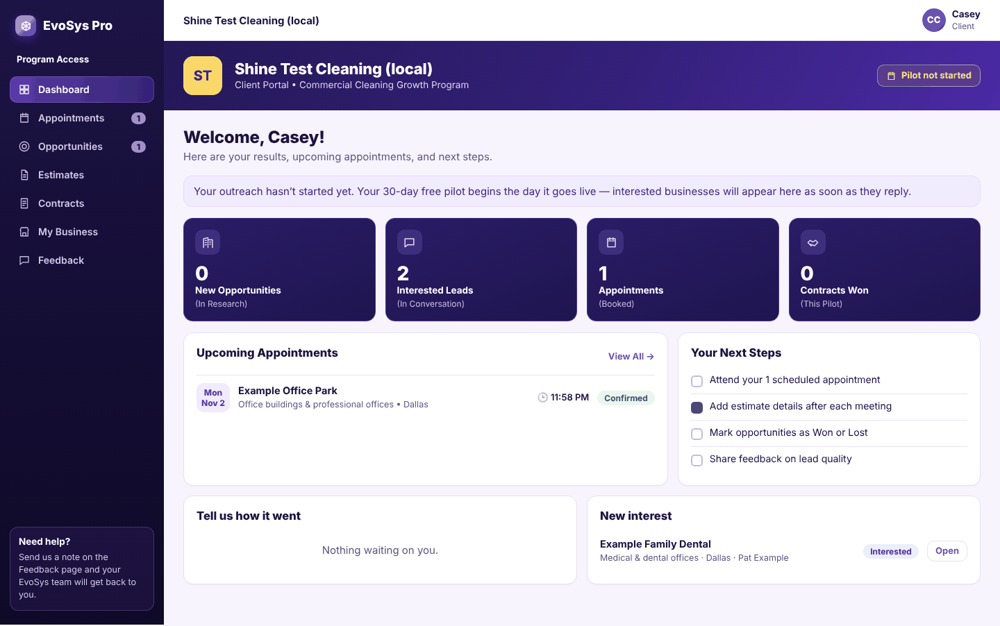 | 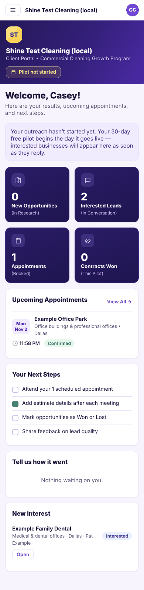 |
| Client appointments | 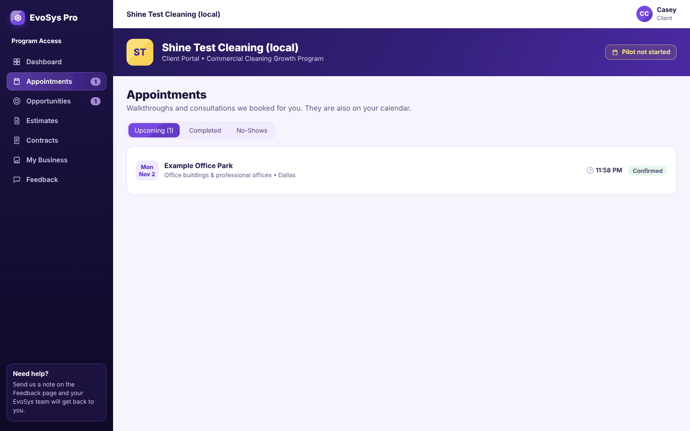 | 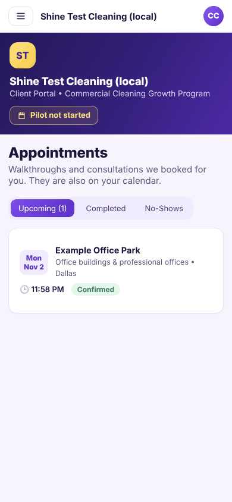 |
| Client opportunity + outcomes | 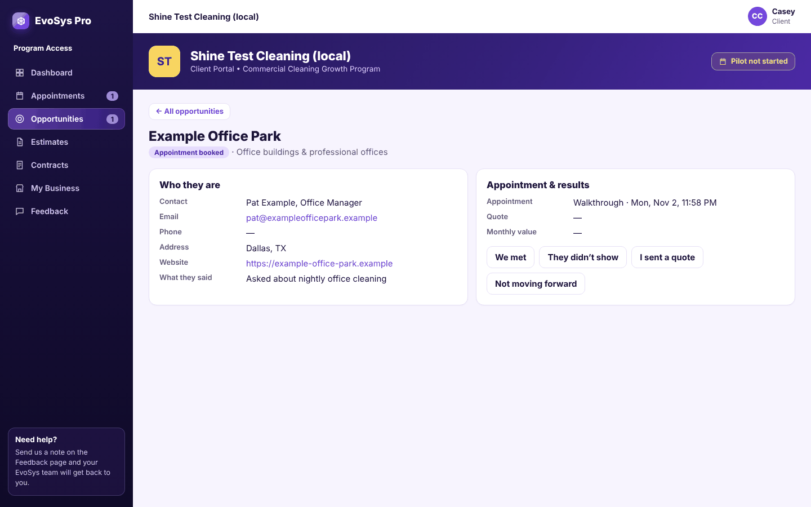 | 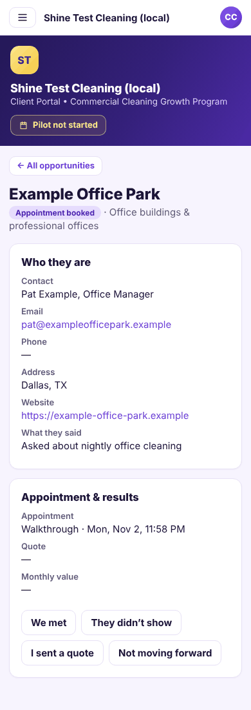 |
| Client contracts | 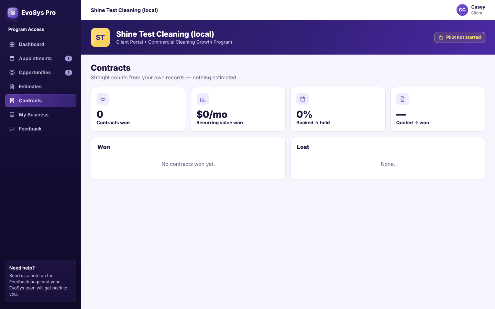 | 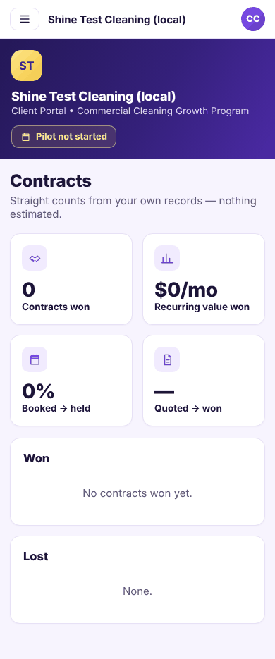 |
| Operator Program Access card | 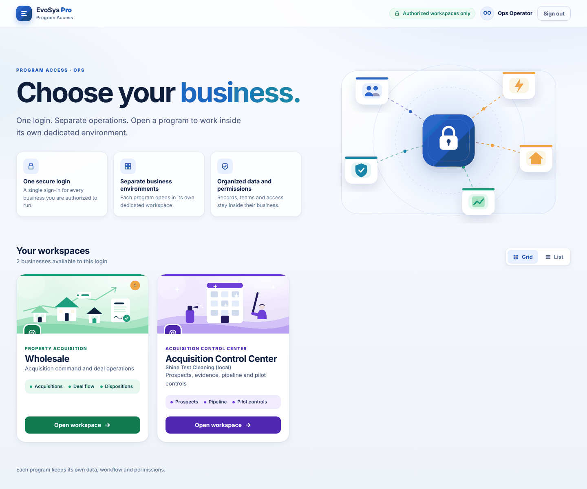 | |
| Acquisition Control Center | 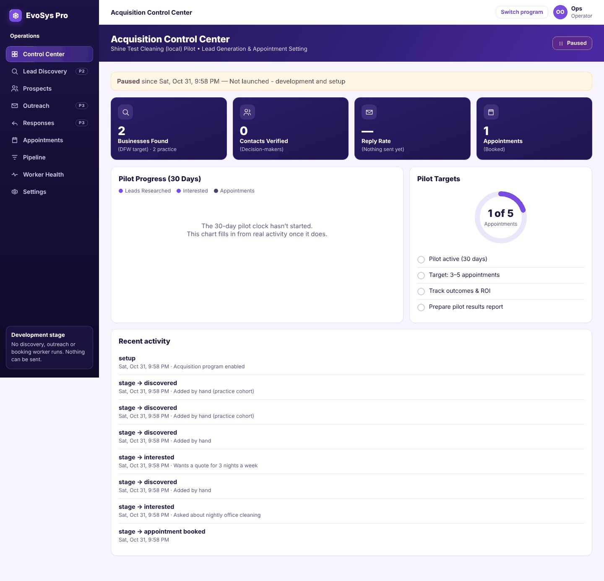 | 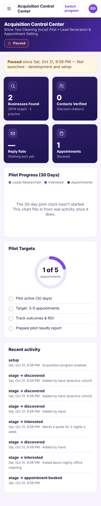 |
| Prospects + signals/evidence | 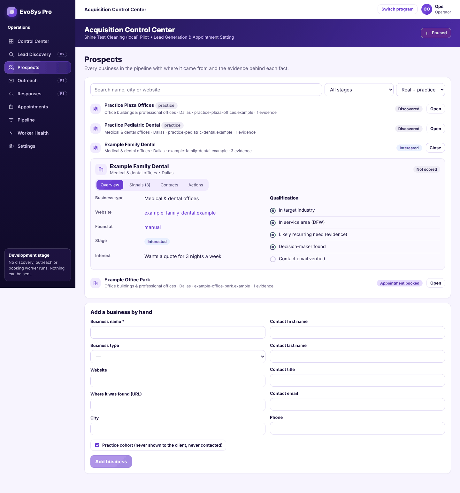 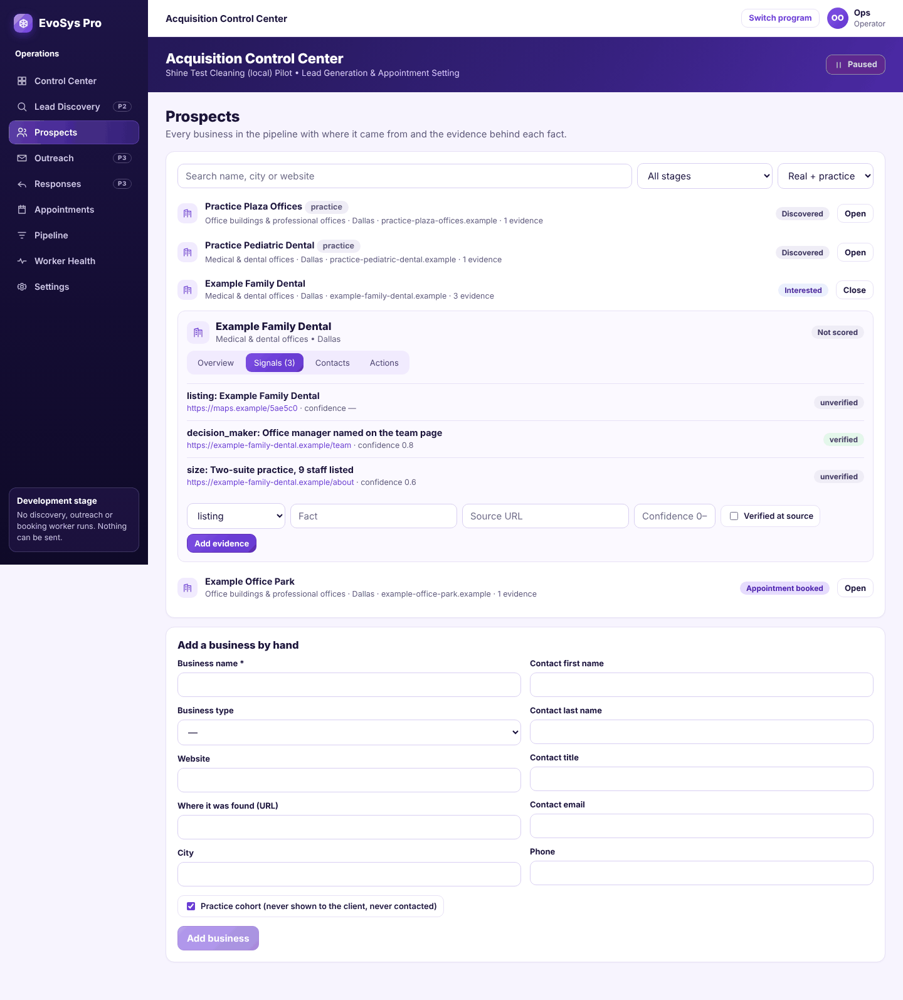 | |
| Pipeline | 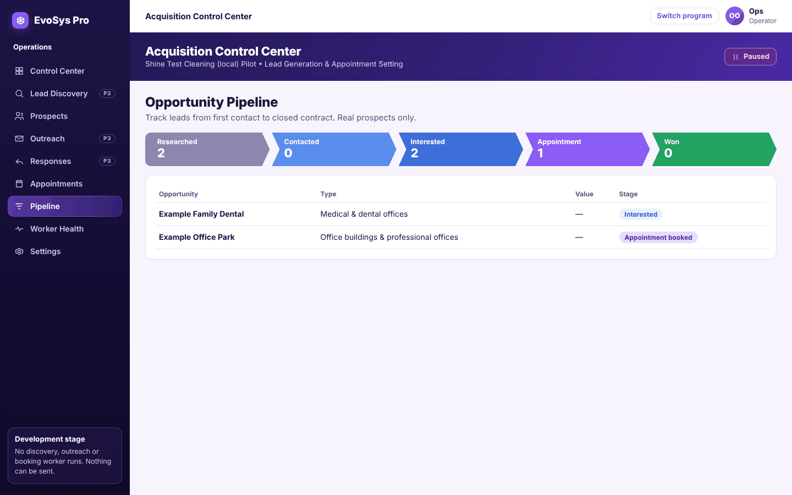 | |
| Owner settings and operator grants (God only) | 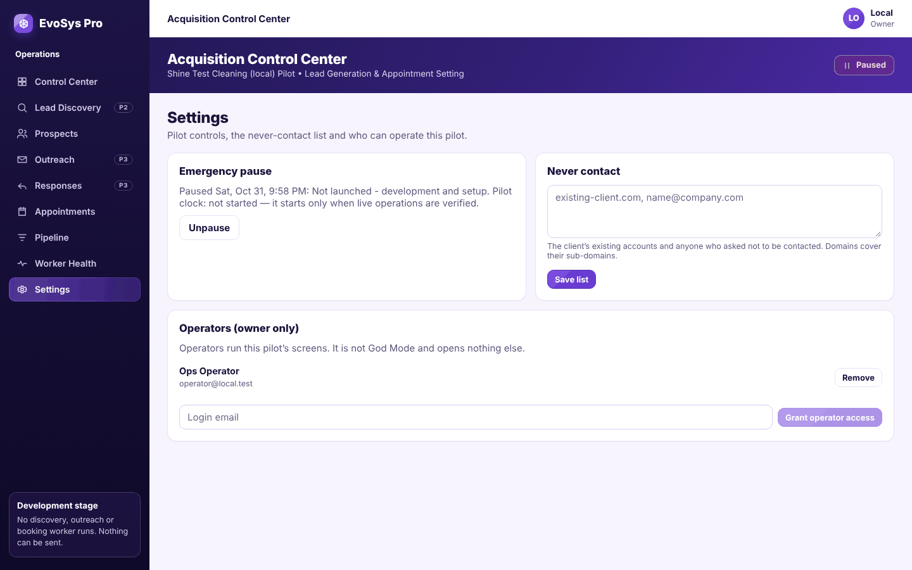 | |

What the browser run confirmed:
- **The client:**
  - She lands on her portal after signing in, and sees 0 practice rows.
  - `/acquisition-ops` tells her she has no acquisition access (the server returns 403).
- **The operator:** the test login is shaped like wholesale@: a Wholesale-locked `org_admin` with a granted operator role.
  - Program Access shows the purple **Acquisition Control Center** card, and it opens `/acquisition-ops`.
  - The owner-only "Operators" controls are hidden.
  - `/god` does not open God Mode.
  - `/dashboard` still sends this login to Wholesale.
- **The owner (God):** `/god/acquisition` redirects to `/acquisition-ops`.
- **Console:** no errors apart from the expected 403 when the client tries `/acquisition-ops`.
